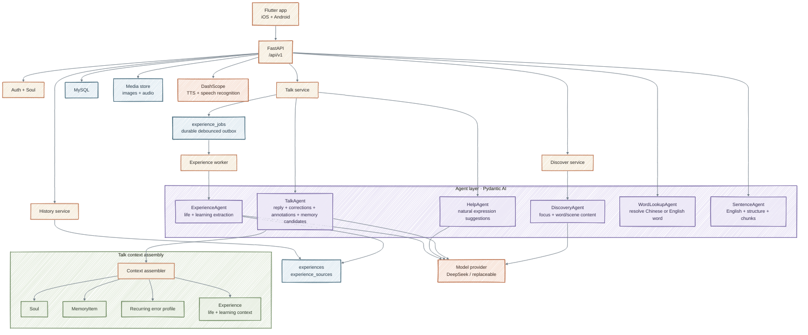
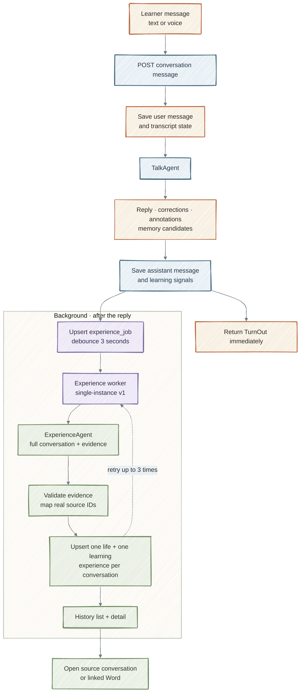
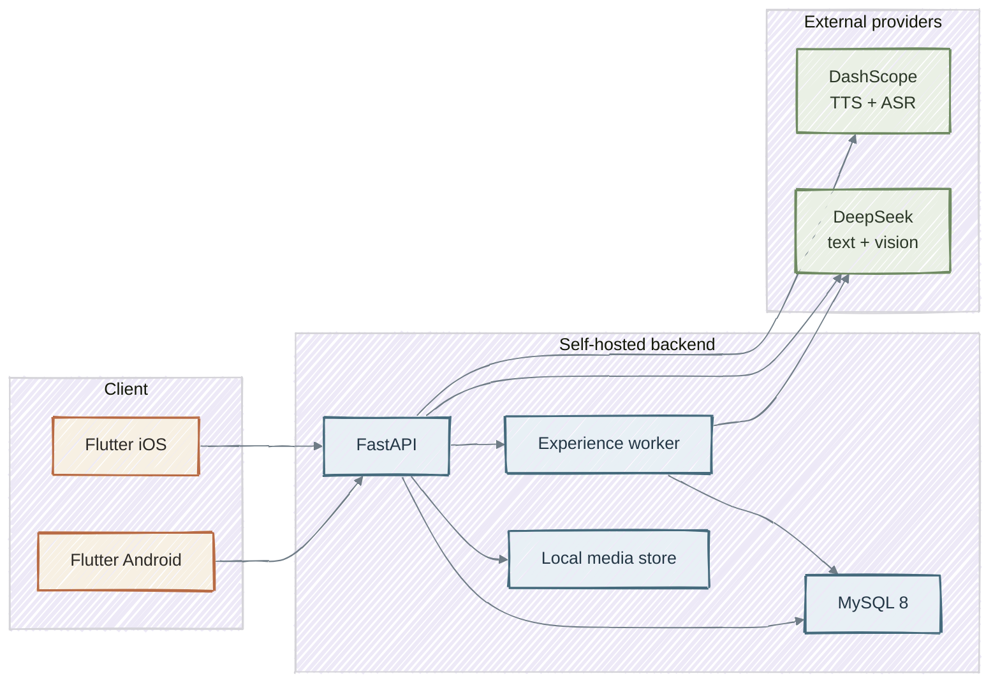

# Named

**AI that turns everyday moments into English conversations.**

Explore what you see, talk about what matters to you, and build your own world of English memories.


## Why Named exists

Most English tools teach words in isolation. The learner remembers the word for a test, but has no relationship with it.

Named starts from the learner's real life:

- a tree seen in the park
- a watering can in the garden
- a moment shared with a daughter
- a thought the learner wants to say but cannot express yet

The product turns those moments into a personal learning loop:

**Discover → Talk → Understand → Save → Review → Reuse**

The goal is not to complete a fixed curriculum. It is to build **your own world of English memories**: English grounded in what you noticed, what you shared, and what you returned to.

## Core features

| Area | What the learner can do |
| --- | --- |
| **Discover** | Start with text or a photo. AI identifies the focus and generates a Word or Scene with simple English, native-language support, examples, and pronunciation. |
| **Words** | Keep a personal word shelf with statuses, US/UK pronunciation, playback speed, pause/resume, and a lightweight Review flow. |
| **Talk** | Enter a conversation from a Word or Scene, type or speak, receive natural replies, corrections, grammar/word annotations, and audio. |
| **Voice Talk** | Record a turn, transcribe it, and send automatically after stopping. Empty recordings return quietly without an error. |
| **Accurate English** | Chinese input gets a natural English version; English with a clear error gets the complete corrected sentence. Already-natural English is not repeated. |
| **Text selection** | Long-press any Talk message to copy, open Word details for a word, or open Sentence details for a phrase/sentence. Sentence details explain the English and provide Listen. |
| **Help me say it** | Ask for a natural English expression, hear it, and insert it into Talk without turning the exchange into a grammar lecture. |
| **Experience + History** | After Talk, an asynchronous agent extracts meaningful life and learning experiences. History lets the learner revisit them, and Talk/Help can use relevant experiences as context. |
| **Companion memory** | Milo can use relevant prior context, recurring learning errors, and explicit memories without exposing an internal memory-management screen. |
| **Soul** | Keep a lightweight, user-owned profile that guides personalization. Soul is not inferred from private content or silently rewritten from practice. |
| **Account lifecycle** | Email-code authentication, opaque sessions, account deletion, and a 30-day hard-delete purge. |

### Experience versus Memory

These are deliberately separate:

| Layer | Purpose | Visible to learner |
| --- | --- | --- |
| **Conversation** | Original dialogue, corrections, annotations, and audio | Yes, Talk |
| **MemoryItem** | Internal context for Milo, deduplicated and weighted | No |
| **Experience** | User-facing life/learning experience with provenance | Yes, History |
| **Soul** | User-provided profile and explicit personal context | Yes |

An Experience is not a chat summary. It is a small, sourced record such as:

- **Life experience**: “和女儿在公园的树荫下休息。”
- **Learning experience**: “练习了 `under the tree`，并纠正了第三人称单数。”

Practice, hypotheticals, role-play, and AI-generated examples cannot become life experiences.

## Agent architecture

Named uses **Pydantic AI** with a replaceable model string (currently DeepSeek text/vision). Agents are not free-form database writers: each one returns a structured contract, and backend services validate and persist the result.



### Agent contracts

| Agent | Main input | Structured output | Consumer |
| --- | --- | --- | --- |
| **DiscoveryAgent** | Text, image, learner context | Focus kind, candidates, Word/Scene payload, warnings | Discover |
| **TalkAgent** | Focus, Soul, memory, recurring errors, history, new message | Reply, native translation, user-English hint, corrections, annotations, memory candidates | Talk |
| **HelpAgent** | Desired idea, focus, relevant history | Natural English, note, alternatives | “Help me say it” |
| **ExperienceAgent** | Full conversation with message sequence numbers, focus, corrections, annotations | At most one life and one learning candidate with evidence and confidence | Experience worker |
| **WordLookupAgent** | Selected Chinese or English word | One English word to look up | Word lookup |
| **SentenceAgent** | Selected phrase or sentence | English version, explanation, structure, chunks, key words | Sentence details |

### Guardrails

- Agents return structured data; deterministic services enforce ownership, limits, source relationships, and persistence.
- Experience evidence must reference real messages in the same conversation.
- Life experiences require explicit user facts; practice and hypotheticals cannot be promoted to real life.
- Talk and Help failures use a bounded, user-readable error contract. Experience extraction failure never fails the Talk turn.
- Account deletion removes account-scoped data; shared content-addressed audio caches are retained.

## Talk and Experience pipeline

Talk is the main product surface. Experience extraction is intentionally **asynchronous** so a good reply is not delayed by history-quality work.



The worker is a durable database-backed job loop inside the API process for v1. It does not require Redis or Celery. A process restart leaves pending work recoverable.

## Runtime topology



## Repository layout

```text
.
├── app/                  Flutter app (iOS + Android)
├── backend/              FastAPI + SQLAlchemy + Alembic backend
├── docs/
│   ├── feature/          Pre-PRD requirements discussions
│   ├── prototypes/       Interactive HTML/CSS/JS design prototype
│   ├── prd-v1.0.md       Product definition and scope
│   └── ui-ux-design.md   Visual and interaction direction
├── final/                Exported design boards
└── AGENTS.md             Engineering workflow and repository conventions
```

## Explore the design

- [Open the interactive mobile prototype](docs/prototypes/named.html) directly in a browser. No installation or build step is required.
- [View the three-screen design board](final/00-overview.png).
- [Read the prototype guide](docs/prototypes/named-guide.md) for flows, screens, and demo limitations.

Keep the prototype's HTML, CSS, JavaScript files, and `assets/` directory together when viewing or sharing it.

## Product documents

- [PRD V1.0](docs/prd-v1.0.md): product definition, first-version scope, and acceptance criteria.
- [UI/UX direction](docs/ui-ux-design.md): navigation, screen map, interaction direction, and visual system.
- [Experience + History requirements](docs/feature/v1/experience-and-history/discussion.md): async agent decisions, evidence rules, and History scope.
- [Companion memory requirements](docs/feature/v1/companion-memory/discussion.md): internal memory model and retrieval.
- [Competitive landscape](docs/competitive-landscape.md): researched comparisons and differentiation hypotheses.
- [Visual design files](final/README.md): PNG previews and editable SVG artwork.

## Backend development

The backend lives in `backend/` and uses Python 3.12, FastAPI, SQLAlchemy async, Alembic, MySQL, Pydantic AI, and DashScope.

Requirements: Python 3.12, [uv](https://docs.astral.sh/uv/), Docker, and provider credentials.

```sh
cd backend
cp .env.example .env
uv sync --all-groups
docker compose up -d mysql
make migrate
make dev
```

Useful URLs:

- API: `http://127.0.0.1:8000`
- Swagger UI: `http://127.0.0.1:8000/docs`
- Liveness: `GET /health/live`
- Readiness: `GET /health/ready`

Run MySQL and the API together with Docker:

```sh
cd backend
cp .env.example .env
make docker-up
```

The API container applies Alembic migrations on startup and serves on port 8000. Stop with `make docker-down`.

Backend checks:

```sh
cd backend
make test
make lint
make format-check
```

## Mobile app development

The Flutter app lives in `app/` and was scaffolded from
[`ZhangPeibin/flutter-template`](https://github.com/ZhangPeibin/flutter-template).
It targets iOS and Android and uses FVM with Flutter `3.41.9`.

```sh
cd app
fvm install
fvm flutter pub get
fvm dart run slang
```

Android emulator:

```sh
export PATH="$PWD/.fvm/flutter_sdk/bin:$PATH"
make run-dev
```

iOS simulator:

```sh
export PATH="$PWD/.fvm/flutter_sdk/bin:$PATH"
make run-dev-ios DEVICE=<simulator-id>
```

The dev Android app reaches the backend at `http://10.0.2.2:8000`; the iOS simulator uses `http://localhost:8000`. Start the backend first.

App quality gate:

```sh
cd app
make check
```

For app architecture, feature generation, routes, i18n, and tests, read
[`app/AGENTS.md`](app/AGENTS.md), `app/docs/engineering-standards.md`, and
`app/docs/agent/agent-playbook.md`.

## API overview

All business routes are under `/api/v1`.

| Area | Endpoints |
| --- | --- |
| Auth | `POST /auth/code`, `POST /auth/verify`, `POST /auth/logout`, `GET /me`, `DELETE /me` |
| Soul | `GET /soul`, `PATCH /soul`, `POST /soul/items`, `PATCH /soul/items/{id}`, `DELETE /soul/items/{id}` |
| Discover | `POST /discoveries` (multipart text/image), `POST /discoveries/{id}/focus`, `GET /discoveries/{id}`, `DELETE /discoveries/{id}` |
| Word | `GET /words`, `GET /words/lookup`, `GET /words/{id}`, `PATCH /words/{id}/progress`, `POST /words/{id}/reviewed` |
| Talk | `POST /conversations`, `GET /conversations/{id}`, `POST /conversations/{id}/messages`, `POST /conversations/{id}/end`, `POST /conversations/{id}/help` |
| History | `GET /history`, `GET /experiences/{id}` |
| Sentence | `POST /sentences/lookup` |
| Audio | `POST /audio/speech`, `POST /audio/transcribe`, `POST /audio/pronunciation`, `GET /audio/{key}`, `GET /images/{key}` |

Errors use `application/problem+json` with `code`, `status`, `detail`, and
`request_id`. Every response includes an `X-Request-ID` header.

## Current status

Implemented:

- Email-code authentication and opaque sessions
- Soul profile and items
- Text and image Discover with AI-generated Word/Scene content
- Words, Review, US/UK pronunciation, speed control, pause/resume
- Text and voice Talk with corrections, annotations, idempotent saving, and audio
- Chinese-to-English user-message hints
- Companion memory and recurring error profile
- Account deletion with 30-day hard-delete purge
- Asynchronous Experience extraction, History list/detail, source navigation
- Relevant Experience context injection into Talk and Help
- Accurate English hints for Chinese and corrected English messages
- Long-press copy, Word details, Sentence details, and sentence Listen in Talk
- Problem+json errors, request IDs, rate limits, OpenAPI, backend tests, app tests

Not implemented yet:

- Real-time full-duplex Live Talk / barge-in
- Automatic Soul updates from Experience
- Challenge
- Full Knowledge Graph / Personal English World
- Streaming Talk (SSE)
- Production email delivery, object storage, and deployment automation
- Age gate / parental consent

## Quality

Current local gates:

- Backend: **83** tests, Ruff lint/format
- Flutter app: **93** tests, `make check`
- iOS simulator build
- Android debug APK build

The P0 API contract is covered end to end: authentication, Soul, Discover, Word audio, Talk save/retry, History extraction, account isolation, and deletion.

## Security notes

- Keep secrets in `backend/.env`; never commit real keys.
- `.env` is excluded from the Docker image.
- Logs include request IDs and outcomes, not tokens, verification codes, full conversations, images, or audio.
- Media is local by default; use private object storage for production.
- Rate limiting is in-memory and per process; use a shared store for multiple API instances.
