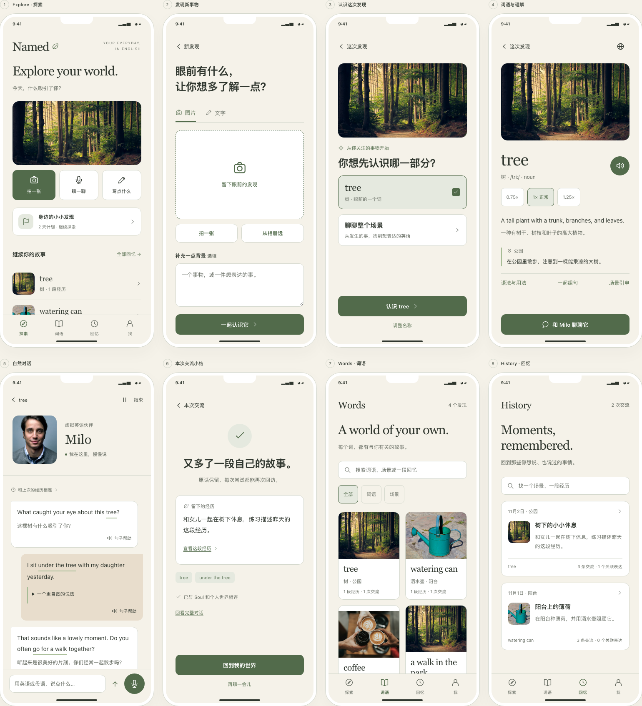
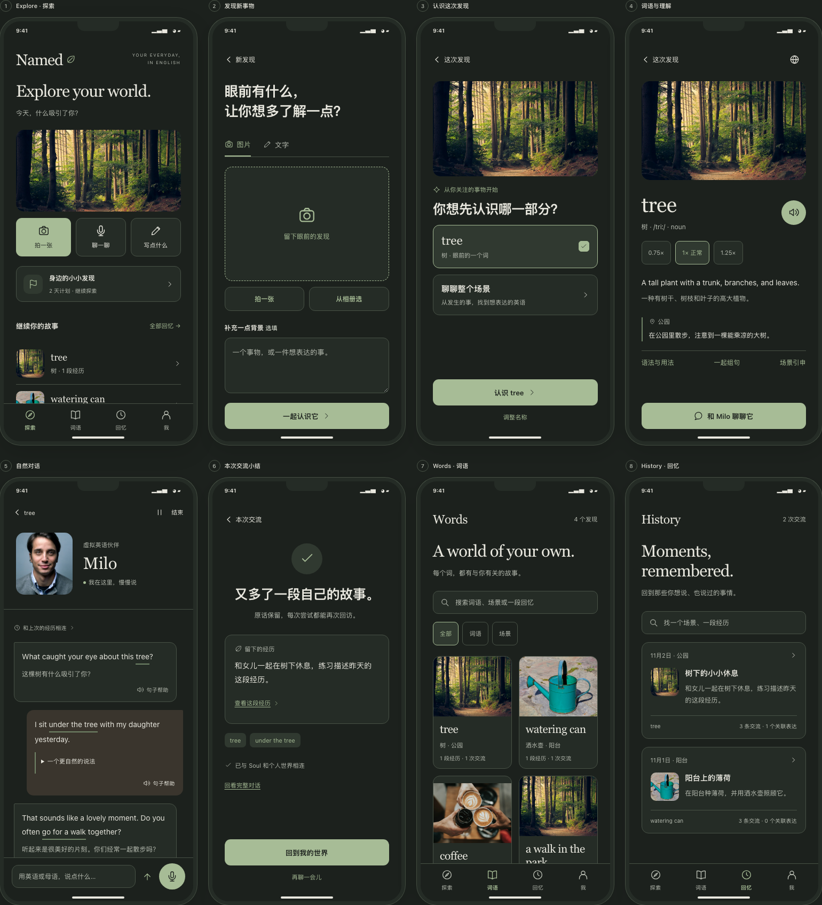

# Named · 最新手机 UI

**Warm Editorial Minimalism · 真实照片 · 明暗主题。**

本轮只采用用户提供 PDF 的视觉和交互指导，名称保持 **Named**。Soul、Experience、Challenge 和 Personal English World 继续保留，产品功能与交付优先级仍以 [PRD](../prd-v1.0.md) 为准。完整设计决策见 [UI/UX 设计说明](../ui-ux-design.md)。

## 打开

浏览器打开 [named.html](named.html)，不需要安装或编译。HTML、CSS、三个 JavaScript 文件和 `assets` 目录应保持在一起。

- [新用户](named.html#new)
- [再次回来](named.html#returning)
- [挑战进行中](named.html#active)
- [空内容](named.html#empty)
- [倾听](named.html#listening) / [未听清和保存重试](named.html#retry)
- [全部页面](named.html#overview)

默认外观跟随系统。顶部评审工具或 **我 → 使用偏好 → 主题** 可以选择浅色、深色或跟随系统。外观偏好保留在本地，其他模拟数据刷新或重置后恢复。

手机体验模式全屏展示 App，评审工具隐藏。桌面端右侧目录可跳页并注入识别、发言和失败状态。

## 四个主入口

| 入口 | 做什么 |
| --- | --- |
| **Explore · 探索** | 拍照、聊一聊、写点什么；继续当前挑战或最近故事 |
| **Words · 词语** | 搜索个人词语／场景，从中进入关联内容 |
| **History · 回忆** | 按日期、场景和话题找回交流，再从原对话继续 |
| **Me · 我** | 查看有意义的积累、Soul、个人经历、Challenge 和偏好 |

Talk 从内容与情境进入，作为独立对话页呈现。

## 当前预览

### 引导

兴趣 → 年龄 → 性别 → 母语和简短日常，支持返回、跳过及后续修改。

[浅色](named-onboarding.png) · [深色](named-onboarding-dark.png)

单页：[兴趣](named-01-onboard.png) · [年龄](named-onboard-02-age.png) · [性别](named-onboard-03-gender.png) · [日常与母语](named-onboard-04-life.png)

### 探索、理解与交流

单页：[Explore](named-02-home.png) · [Discover](named-03-discover.png) · [发现结果](named-discovery-result.png) · [Word](named-04-word.png) · [Talk](named-05-talk.png) · [小结](named-06-experience.png) · [Words](named-07-world.png) · [History](named-history-list.png)

### 个人世界与挑战

[浅色](named-personal-world.png) · [深色](named-personal-world-dark.png)

单页：[词语关联](named-connections.png) · [挑战列表](named-challenges.png) · [创建](named-challenge-new.png) · [挑战详情](named-challenge-detail.png) · [完整原对话](named-08-history.png) · [经历](named-experience-detail.png) · [Me / Soul](named-soul.png) · [偏好](named-preferences.png)

### 状态与辅助层

[浅色状态](named-states.png) · [深色状态](named-states-dark.png) · [词语帮助](named-word-help.png) · [句子帮助](named-sentence-help.png)

## 推荐体验路径

### 第一次进入

1. 完成或跳过四步 Soul。
2. Explore 选择拍照、输入或直接分享一个情境。
3. 确认关注的对象或整个场景，理解词语并进入对话。
4. 输入自己的表达，点开词语或整句帮助。
5. 结束交流，查看浓缩经历和来源。
6. 从 Words 或 History 找回刚才的内容。

### 回看并继续

1. 载入再次回来的用户。
2. History 找到「树下的小小休息」，或从 tree 的关联页进入。
3. 阅读原话，按需展开表达建议，查看关联经历。
4. 继续交流，新增分享后结束。
5. 在 History、词语关联与 Me 中找回同一份来源。
6. 修改经历摘要，检查原始交流仍然保留。

### 按自己的周期学

创建 Challenge → 设定名称与天数 → 勾选内容 → 继续探索 → 结束本轮 → 随时回顾。结束不删除知识和经历，打开进度不表示已经掌握。

## 视觉与交互变化

- 主背景为暖象牙色或深森林色，绿色用于品牌和交互状态。
- 真实生活图片替代插画；照片已本地打包，来源见 [素材说明](assets/README.md)。示例图片不代表用户实际上传或真实导师。
- 虚拟伙伴形象使用克制的参考肖像，文字和操作放在图片外，避免忙乱背景。
- 词语、句子和表达建议按需展开；原始表达不被纠正结果覆盖。
- History 直接读取对话和经历来源，不维护另一套脱节的聊天列表。
- Me 使用实际发现、交流和表达数量，不设置虚构的掌握分数。
- 所有旧预览已由本轮覆盖，旧 SVG 插画实现已移除；明暗图片是同一设计的两个主题。

## 演示边界

AI 回复、图片识别、语音、保存服务与经历提炼仍为模拟。新增经历以用户原话作摘要；真实提炼、持久化和语音服务尚未接入。

语音按钮演示倾听／未听清状态；回放按钮展示入口。输入内容只保留在当前页面会话，照片只在本地预览。只有外观选择会保留到下次打开。

内置照片、词语材料和人物用于评审。母语解释主要使用中文样例，其他语言未接入生成。完整生产环境的身份、同步和词义处理仍属于后续技术实现。

## 验证

已验证四步引导、三种探索入口、多个词语和情境、共享 History、句子／词语帮助、来源保留的经历修改、历史续聊、识别／保存重试、灵活周期挑战、明暗／系统主题和模态键盘焦点。

在 **360、390、430px × 浅色／深色** 下检查 **23 个页面状态** 的布局和底部操作；在两主题的 390px 页面中执行 **46 次页面状态文字对比度检查**，按普通文字 4.5:1、大字 3:1 阈值验证实际前景／背景配对。
